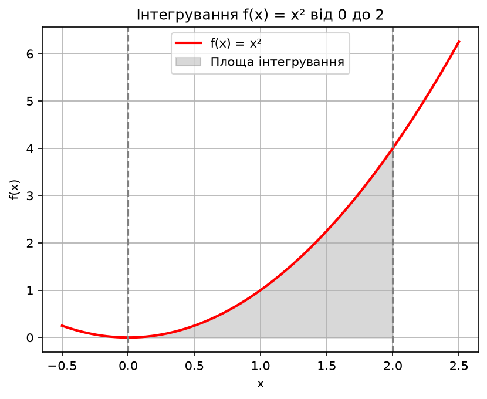

# Домашня робота №10

## Завдання 1. Жадібний алгоритм та динамічне програмування

Реалізовано дві функції для видачі решти:
- `find_coins_greedy()` — жадібний алгоритм;
- `find_min_coins()` — динамічне програмування.

Використані номінали монет: [50, 25, 10, 5, 2, 1].

### Результати вимірювання часу

Час виміряно за допомогою `timeit` за 10 запусків.

| Сума | Жадібний алгоритм (с) | Динамічне програмування (с) |
|------|------------------------|-----------------------------|
| 113 | 0.000028 | 0.000888 |
| 1000 | 0.000016 | 0.011325 |
| 10000 | 0.000021 | 0.174712 |

### Висновки

Жадібний алгоритм виявився швидшим для всіх
досліджених сум. Його часова складність
становить O(k), де k — кількість номіналів.

Алгоритм динамічного програмування має
часову складність O(amount * k), оскільки
перевіряє можливі номінали для кожної суми.

Жадібний алгоритм ефективніший за швидкістю,
але не завжди знаходить мінімальну кількість
монет для довільного набору номіналів.

Динамічне програмування гарантує оптимальний
результат, хоча потребує більше часу та пам'яті.

## Завдання 2. Метод Монте-Карло

Реалізовано алгоритм обчислення визначеного
інтеграла методом Монте-Карло.

Для дослідження обрано функцію:

f(x) = x²

Межі інтегрування: від 0 до 2.

Кількість випадкових точок: 100000.

### Результати

- Метод Монте-Карло: 2.675200
- Аналітичне значення: 2.666667
- Результат scipy.integrate.quad: 2.666667
- Абсолютна похибка: 0.008533
- Відносна похибка: приблизно 0.32%

### Висновки

Метод Монте-Карло дозволив отримати наближене
значення визначеного інтеграла функції f(x) = x².

Отримане значення 2.675200 є близьким
до точного результату 2.666667.

Відносна похибка становить приблизно 0.32%,
що свідчить про достатню точність методу
для проведеного експерименту.

Результат функції scipy.integrate.quad
практично збігається з аналітичним значенням.

Метод Монте-Карло використовує випадкові точки,
тому результати можуть відрізнятися
при повторних запусках програми.

Збільшення кількості випадкових точок зазвичай
підвищує точність оцінки, але потребує
більше часу на обчислення.

Для простих одновимірних інтегралів метод quad
зазвичай є точнішим та ефективнішим.
### Графік інтегрування

